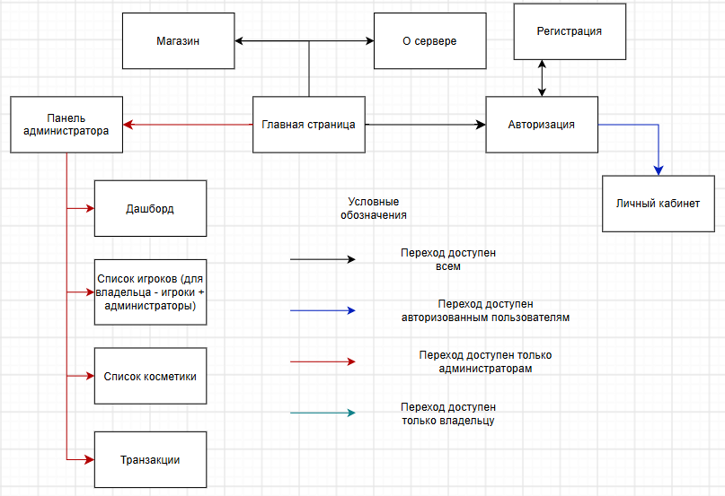
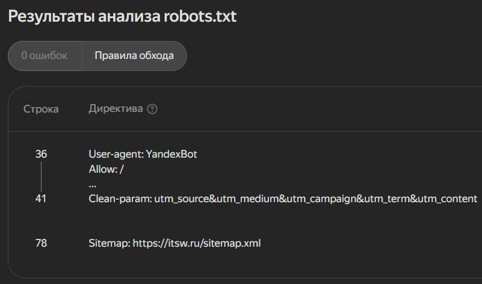
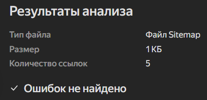

# Лабораторная работа №3. Структура сайта и карта сайта

### Тематика сайта - сервер Minecraft

На рисунке 1 представлена карта сайта



Рисунок 1. Карта сайта

В листинге 1 представлен sitemap.xml для сайта

```
<urlset xmlns="http://www.sitemaps.org/schemas/sitemap/0.9" xmlns:news="http://www.google.com/schemas/sitemap-news/0.9" xmlns:xhtml="http://www.w3.org/1999/xhtml" xmlns:image="http://www.google.com/schemas/sitemap-image/1.1" xmlns:video="http://www.google.com/schemas/sitemap-video/1.1">
<url>
<loc>https://itsw.ru/</loc>
<lastmod>2026-11-10T10:07:17.393Z</lastmod>
<changefreq>daily</changefreq>
<priority>1.0</priority>
</url>
<url>
<loc>https://itsw.ru/shop</loc>
<lastmod>2026-11-10T10:07:17.393Z</lastmod>
<changefreq>daily</changefreq>
<priority>0.9</priority>
</url>
<url>
<loc>https://itsw.ru/about</loc>
<lastmod>2026-11-10T10:07:17.393Z</lastmod>
<changefreq>monthly</changefreq>
<priority>0.5</priority>
</url>
<url>
<loc>https://itsw.ru/login</loc>
<lastmod>2026-11-10T10:07:17.393Z</lastmod>
<changefreq>yearly</changefreq>
<priority>0.3</priority>
</url>
<url>
<loc>https://itsw.ru/register</loc>
<lastmod>2026-11-10T10:07:17.393Z</lastmod>
<changefreq>yearly</changefreq>
<priority>0.3</priority>
</url>
</urlset>
```

Листинг 1. sitemap.xml

В листинге 2 представлен robots.txt для сайта

```
User-agent: *
Allow: /
Disallow: /admin/
Disallow: /profile/
Disallow: /api/
User-agent: Googlebot
Allow: /
Disallow: /admin/
Disallow: /profile/
Disallow: /api/
User-agent: Googlebot-News
Allow: /
Disallow: /admin/
Disallow: /profile/
Disallow: /api/
User-agent: Googlebot-Image
Allow: /
Disallow: /admin/
Disallow: /profile/
Disallow: /api/
User-agent: Googlebot-Video
Allow: /
Disallow: /admin/
Disallow: /profile/
Disallow: /api/
User-agent: Mediapartners-Google
Allow: /
Disallow: /admin/
Disallow: /profile/
Disallow: /api/
User-agent: AdsBot-Google
Allow: /
Disallow: /admin/
Disallow: /profile/
Disallow: /api/
User-agent: YandexBot
Allow: /
Disallow: /admin/
Disallow: /profile/
Disallow: /api/
Clean-param: utm_source&utm_medium&utm_campaign&utm_term&utm_content
User-agent: YandexImages
Allow: /
Disallow: /admin/
Disallow: /profile/
Disallow: /api/
User-agent: YandexMetrika
Allow: /
Disallow: /admin/
Disallow: /profile/
Disallow: /api/
User-agent: YandexTurbo
Allow: /
Disallow: /admin/
Disallow: /profile/
Disallow: /api/
User-agent: YandexMobileBot
Allow: /
Disallow: /admin/
Disallow: /profile/
Disallow: /api/
User-agent: YandexAccessibilityBot
Allow: /
Disallow: /admin/
Disallow: /profile/
Disallow: /api/
User-agent: YandexAdditional
Allow: /
Disallow: /admin/
Disallow: /profile/
Disallow: /api/
User-agent: YandexAdditionalBot
Allow: /
Disallow: /admin/
Disallow: /profile/
Disallow: /api/

Sitemap: https://itsw.ru/sitemap.xml
```
Листинг 2. robots.txt

На рисунке 2 представлена проверка robots.txt



Рисунок 2. Проверка robots.txt

На рисунке 3 представлена проверка sitemap.xml



Рисунок 3. Проверка sitemap.xml

Контрольные вопросы:

1. Структура сайта - это иерархия страниц, разделов и категорий, которая определяет связи между ними. Она напрямую влияет на UX: пользователю проще найти информацию, если навигация логична, а количество кликов до нужной страницы минимально. Для SEO структура определяет, насколько глубоко поисковый робот сможет проиндексировать сайт; плоская и логичная структура ускоряет обход, а "глубокие" страницы (требующие множества кликов) могут выпадать из индекса;

2. sitemap.xml - это XML-файл, который служит "картой" для поисковых роботов. Он сообщает им обо всех страницах сайта, которые нужно проиндексировать, и о метаданных этих страниц (когда обновлялись, как часто меняются).

3. &lt;urlset&gt; и &lt;loc&gt;

4. &lt;lastmod&gt; указывает дату последнего изменения, &lt;changefreq&gt; указывает частоту обновления, &lt;priority&gt; указывает приоритет относительно других страниц на сайте.

5. Поисковые системы требуют, чтобы в теге &lt;loc&gt; был указан абсолютный URL, включающий протокол (http/https) и домен. Это необходимо для однозначной идентификации страницы, так как относительные пути могут быть неверно интерпретированы при обработке файла.

6. Связь sitemap и robots.txt вот так устанавливается:

```
Sitemap: https://{URL}/sitemap.xml
```

7. sitemap.xml может содержать не более 50000 URL-адресов и размер не должен превышать 50 МБ

8. Sitemap Index - это файл-контейнер (обычно sitemap_index.xml), который ссылается на несколько отдельных файлов sitemap.xml. Следует использовать когда один файл слишком большой и необходимо разбить на несколько

9. Для многоязычных сайтов используется атрибут hreflang. В sitemap.xml он реализуется через расширение xhtml:link. Для каждой страницы надо указывать её саму и все её языковые версии с соответствующими кодами языков (например, ru, en).

10. Несуществующие страницы (404), редиректы (301, 302), а также страницы, заблокированные в robots.txt

11. Для динамических разделов sitemap.xml должен генерироваться автоматически на основе данных из базы (CMS). При добавлении новой статьи или товара карта сайта должна обновляться.

12. Отдельные карты сайта (или расширения в основном sitemap.xml) используются для специфического контента:

Изображения: помогают Google находить и индексировать картинки, что важно для трафика из поиска по изображениям.

Видео: позволяют передать метаданные видео (название, описание, обложка, длительность), что необходимо для попадания в видео-выдачу.

Новости: имеют очень строгие требования (публикация за последние 48 часов) и используются для попадания в Google News.