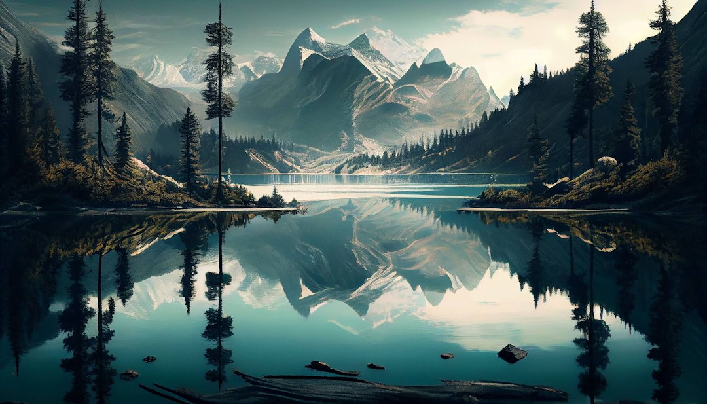
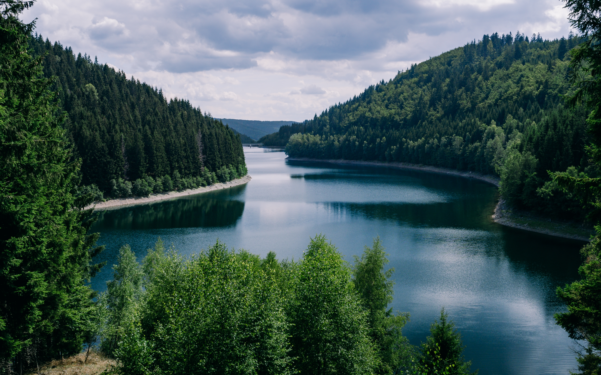
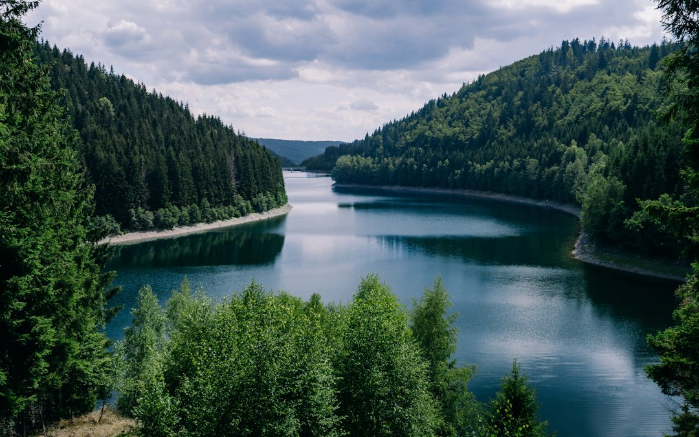
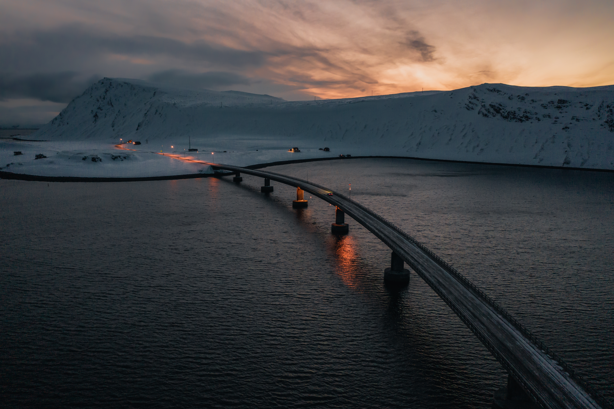
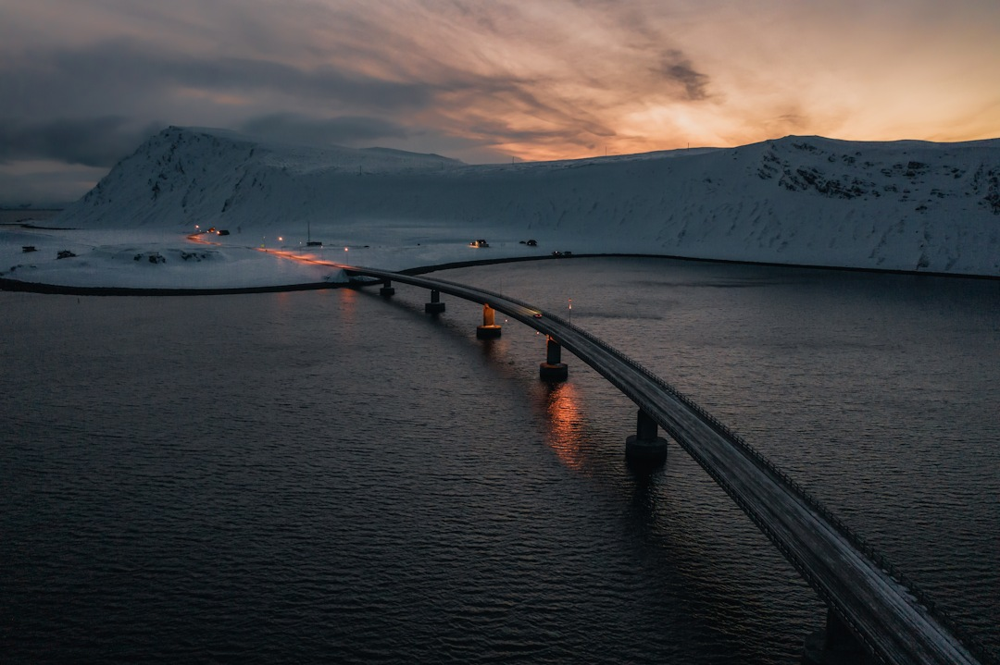

# Практическая работа №3. Оптимизация изображений

## Задание 1. Оптимизация изображений

### Изображение 1

На рисунке 1 представлено изображение размером 5600х3200

Рисунок 1. Изображение размером 5600х3200

Изображение весит 7069 КБ. Задача: оптимизировать до такого момента, где размер изображения не превышает 200 КБ. 

С помощью Paint.NET размер изображения был уменьшен до 1080х617, а также было уменьшено качество изображения. Результат - изображение имеет размер 182 КБ (см. рисунок 2)

Рисунок 2. Оптимизированное изображение размером 1080х617

### Изображение 2

Далее, на рисунке 3 представлено изображение, имеющее разрешение 4381х2738 и размер 9090 КБ. 

Рисунок 3. Изображение разрешением 4381х2738

С помощью Paint.NET размер изображения был уменьшен до 1080х675, а также было уменьшено качество изображения. Результат - изображение имеет размер 197 КБ (см. рисунок 4)

Рисунок 4. Оптимизированное изображение размером 1080х675

### Изображение 3

Далее, на рисунке 5 представлено изображение, имеющее разрешение 5464х3640 и размер 12093 КБ. 

Рисунок 5. Изображение размером 5464х3640

С помощью Paint.NET размер изображения был уменьшен до 1080х719, а также было уменьшено качество изображения. Результат - изображение имеет размер 184 КБ (см. рисунок 6)

Рисунок 6. Оптимизированное изображение размером 1080х719