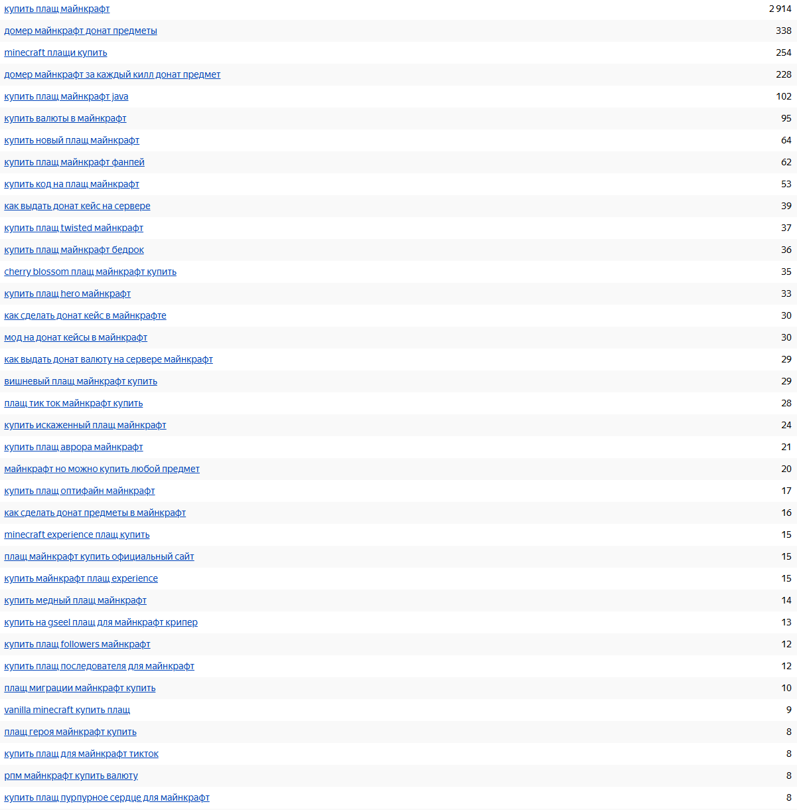
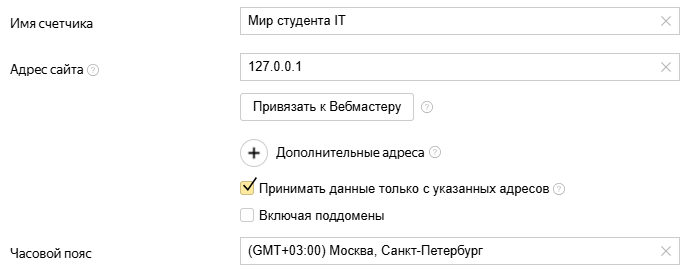

# Симонов Е.Д. 4ИСИП-923. Тема 2: Разработка стратегии контекстной рекламы

<strong>Цель:</strong> разработать стратегию контекстной рекламы для собственного веб-приложения: определить цели и показатели эффективности рекламной кампании, собрать и сгруппировать ключевые запросы, составить рекламные объявления, рассчитать бюджет и подготовить структуру кампании в системе Яндекс.Директ, а также настроить отслеживание результатов рекламы.

<strong>Предметная область:</strong> веб-приложение Minecraft-сервера "Мир студента IT"

## 1. Объект продвижения, цели и показатели эффективности

<strong>Объект продвижения:</strong> веб-приложение игрового сообщества Minecraft "Мир студента IT". 

<strong>Продвигаемый товар:</strong> внутриигровая косметика для персонажей Minecraft (плащи, шляпы, крылья)

### Целевая аудитория:

- <strong>Пол:</strong> преимущественно мужской (около 70%), но также девушки (30%);

- <strong>Возраст:</strong> 14-25 лет (основная масса - школьники и студенты);

- <strong>География:</strong> Россия, страны СНГ (Казахстан, Беларусь), русскоязычное население;

- <strong>Интересы:</strong> компьютерные игры (особенно Minecraft), киберспорт, стриминг;

- <strong>Потребность:</strong> желание выделяться среди других игроков, уникальный внешний вид персонажа, удобные и безопасный способ покупки косметики с прозрачной историей транзакций.

<strong>Цель рекламной кампании по методике SMART:</strong> получить 50 регистраций на сайте и не менее 15 первых покупок косметики за первый месяц рекламной кампании при средней стоимости привлечения одного покупателя (CPA) не более 400 рублей.

### Ключевые показатели эффективности (KPI):

1. Показы: количество отображений рекламного объявления;

2. Клики: количество переходов по объявлению на сайт;

3. CTR (Click-through rate): отношение кликов к показам;

4. CPC (Cost per click): средняя цена клика;

5. CPA (Cost per action): цена целевого действия;

6. ROI (Return on investment): окупаемость.

## 2. Сбор и группировка ключевых запросов

На рисунке 1 представлены запросы, по которым целевая аудитория может искать подобные проекты



Рисунок 1. Запросы, по которым целевая аудитория может искать подобные проекты

Минус-слова для исключения нецелевых показов:

бесплатно, скачать, взлом, чит, вакансии, работа, своими руками, конструктор, курсы, обучение, для начинающих, как сделать, своими силами, без регистрации, атернос, пиратка, сервер на телефон, как, сделать, выдать, мод, взять

### Группировка запросов

В списке на рисунке 1 37 запросов. Их можно разделить на 3 основные группы по смыслу и коммерческой ценности

1. Группа 1 "Покупка косметики"

Это запросы, где пользователь уже готов к покупке и ищет конкретный товар. Это основная целевая группа.

- купить плащ майнкрафт

- minecraft плащи купить

- купить новый плащ майнкрафт

- купить код на плащ майнкрафт

- плащ майнкрафт купить официальный сайт

- купить плащ майнкрафт java

- купить плащ майнкрафт бедрок

- vanilla minecraft купить плащ

- купить плащ майнкрафт фаней

- купить плащ для майнкрафт тикток

- плащ тик ток майнкрафт купить

- купить майнкрафт плащ experience

- minecraft experience плащ купить

- купить плащ оптифайн майнкрафт

- cherry blossom плащ майнкрафт купить

- вишневый плащ майнкрафт купить

- купить плащ twisted майнкрафт

- купить плащ hero майнкрафт

- плащ героя майнкрафт купить

- купить искаженный плащ майнкрафт

- купить плащ аврора майнкрафт

- купить медный плащ майнкрафт

- купить на qseel плащ для майнкрафт крипер

- купить плащ followers майнкрафт

- купить плащ последователя для майнкрафт

- плащ миграции майнкрафт купить

- купить плащ пурпурное сердце для майнкрафт

2. Группа 2 "Донат, кейсы и валюта"

Здесь пользователи ищут конкретные игровые ценности. Часто это те, кто уже играет на серверах и готов потратить деньги на развитие или внешний вид.

- домер майнкрафт донат предметы

- домер майнкрафт за каждый килл донат предмет

- купить валюты в майнкрафт

- рпм майнкрафт купить валюту

- майнкрафт но можно купить любой предмет

3. Группа 3 "Информационные/нецелевые"

Эти запросы нужно исключить. Люди ищут инструкции или бесплатные способы, а не готовый магазин

- как выдать донат кейс на сервере

- как сделать донат кейс в майнкрафте

- мод на донат кейсы в майнкрафт

- как выдать донат валюту на сервере майнкрафт

- как сделать донат предметы в майнкрафт

## 3. Анализ рекламы конкурентов

Для анализа были выбраны три крупных русскоязычных проекта: Cristalix, LoliLand и MineBlaze.

<table>
    <thead>
        <tr>
            <th>Конкурент</th>
            <th>Заголовок объявления (пример)</th>
            <th>Текст объявления (пример)</th>
            <th>Уникальное торговое предложение</th>
            <th>Дополнения</th>
        </tr>
    </thead>
    <tbody>
        <tr>
            <td>Cristalix</td>
            <td>"Легендарные Сервера Minecraft - Cristalix"</td>
            <td>"Более 43 режимов и 12 модсерверов! Уникальные мини-игры, низкий пинг, без лагов. Начни играть прямо сейчас!"</td>
            <td>Огромный выбор режимов и высокотехнологичный проект с онлайном до 7000 игроков.</td>
            <td>Быстрые ссылки: "Начать играть", "Донат", "Форум". Уточнения: "Онлайн 24/7", "Без лагов".</td>
        </tr>
        <tr>
            <td>LoliLand</td>
            <td>"LoliLand - Кубическое приключение"</td>
            <td>"Аниме-проект серверов с уникальными модами. Путешествия по измерениям, технологии и магия. Скачай лаунчер и играй!"</td>
            <td>Уникальная аниме-стилистика и множество авторских дополнений (деревня эльфов, руины и т.д.).</td>
            <td>Быстрые ссылки: "Скачать лаунчер", "Новости", "Магазин"</td>
        </tr>
        <tr>
            <td>MineBlaze</td>
            <td>"MineBlaze - Выживание, БедВарс, Мини-игры"</td>
            <td>"Сервер, где можно оторваться по полной! Честные мини-игры, активное PvP и дружелюбное сообщество. Заходи!"</td>
            <td>Акцент на PvP-составляющую и динамичные мини-игры (BedWars, SkyWars).</td>
            <td>Быстрые ссылки: "IP Сервера", "Донат", "Правила". Уточнения: "Версия 1.8-1.20", "Онлайн 5000+"</td>
        </tr>
    </tbody>
</table>

### Вывод по объявлениям конкурентов:

- Сильные стороны: Все конкуренты делают упор на масштаб (у Cristalix "онлайн до 7000") или на свою уникальную фишку (аниме-стиль у LoliLand). Они используют быстрые ссылки, чтобы закрыть вопросы пользователя

- Слабые стороны: ни один из них не пишет конкретную цену в объявлении. Все обещают "низкие цены" или "без лагов", но конкретики нет. Кроме того, они не рассказывают о безопасности платежей

- Отличие объявления по данному проекту: в своих объявлениях будет делаться упор на прозрачность: игрок видит историю своих покупок, баланс, а косметика не дает читов (Fair Play).

## 4. Составление рекламных объявлений

### Группа 1: Покупка косметики

- Заголовок 1: вариант 1 - "Купить косметику для Minecraft"; вариант 2 - "Косметика для Minecraft"

- Заголовок 2: вариант 1 - "Удобный личный кабинет"; вариант 2 - "Только визуал, без читов"

- Текст: вариант 1 - "Плащи, шляпы, эффекты. Безопасная оплата. История покупок. Заходи!"; вариант 2 - "Выделяйся стилем, не нарушая баланс. Честная игра и прозрачные транзакции"

- Быстрые ссылки: "Магазин", "Личный кабинет", "Как купить", "Техническая поддержка"

- Уточнения: "Безопасно", "Онлайн-оплата", "История операций"

### Группа 2: Донат и кейсы

- Заголовок 1: вариант 1 - "Донат магазин Minecraft"; вариант 2 - "Купить валюту на сервер"

- Заголовок 2: вариант 1 - "Моментальная выдача"; вариант 2 - "Прозрачные транзакции"

- Текст: вариант 1 - "Пополни баланс и купи косметику. Все операции в одном месте. Попробуй!"; вариант 2 - "Никаких скрытых комиссий. Удобный кошелек и история покупок. Присоединяйся!".

UTM-метки:
```
https://itsw.ru/shop?utm_source=yandex&utm_medium=cpc&utm_campaign=cosmetics_purchase&utm_content=ad_a&utm_term=купить_косметику_майнкрафт
```

Пояснение по A/B-тестированию: два варианта объявлений позволяют сравнить, какой из подходов (акцент на удобстве или на честности) привлекает больше кликов и конверсий. Это поможет оптимизировать кампанию с минимальными затратами.

## 5. Расчет бюджета и стратегия показов

- Прогноз CPC: при проверке прогноза бюджета в Яндекс.Директе по "горячим" запросам стоимость клика варьируется от 18 до 32 рублей. Для расчета была взята средняя стоимость в 25 рублей

- Плановая конверсия сайта: базовый показатель в 2%, исходя из средних значений для нишевых интернет-магазинов

- Целевое количество заявок (покупок): 15

- Расчет: для получения 15 покупок при конверсии 2% потребуется 750 кликов (15 / 0.02)

- Бюджет: 750 кликов * 25 рублей (средний CPC) = 18 750 рублей

- Итоговый CPA: 18 750 / 15 = 1 250 рублей. Это выше целевого показателя в 400 рублей.

### Корректировка стратегии:

- Стратегия ставок: ручное управление на старте для сбора статистики, затем переход на "Оптимизацию конверсий"

- География: РФ и СНГ

- Расписание показов: будние дни с 16:00 до 23:00, выходные с 12:00 до 23:00 (пик активности школьников и студентов)

- Снижение CPA: расчетный CPA в 1250 рублей - это слишком дорого. Чтобы снизить его до 400 рублей, мы откажемся от общих и дорогих запросов (например, "лучшие серверы майнкрафт"). Вместо этого сфокусируемся на самых "горячих" запросах на покупку плащей. Также придется доработать сами карточки товаров на сайте, чтобы люди чаще нажимали кнопку "Купить".

### Структура кампании (пример)

```
Кампания: IT Students World — Косметика
├── Группа 1: Покупка косметики (Горячие запросы)
│   ├── Объявление A (Удобство)
│   └── Объявление B (Fair Play)
├── Группа 2: Донат и кейсы (Теплые запросы)
│   ├── Объявление A (Моментальная выдача)
│   └── Объявление B (Прозрачность)
└── Группа 3: Поиск сервера (Теплые запросы)
    ├── Объявление A (Стиль и безопасность)
    └── Объявление B (Сообщество)
```

## 6. Подготовка сайта к приему трафика

На рисунке 2 представлены настройки счётчика Яндекс.Метрики



Рисунок 2. Настройки счетчика

На рисунке 3 представлена настроенная цель на метрике


Рисунок 3. Настроенная цель на метрике

## 7. Выводы по стратегии контекстной рекламы

- Достижимость цели: поставленная цель (15 покупок при CPA <= 400 ₽) при первоначальном расчете труднодостижима. Расчетный CPA составляет ~1250 ₽. Однако, при правильной настройке кампании (фокус на горячие запросы, качественная посадочная страница, A/B-тестирование объявлений) и оптимизации ставок в течение первого месяца, показатель можно приблизить к целевому

- Корректировка кампании: первые корректировки следует проводить через 1–2 недели после запуска, анализируя показатели CTR и конверсии по каждой группе объявлений. Основные метрики для анализа: CPA и ROI

### Сравнение с SEO:

Если сравнить контекстную рекламу с SEO-продвижением, то реклама дает клиентов уже на следующий день после запуска, но требует постоянных вложений (оплата за клики). SEO в свою очередь не даст результата за неделю, но в перспективе года обеспечит бесплатный органический трафик. Для данного проекта контекстная реклама выбрана как основной инструмент для быстрого привлечения первой аудитории.

<strong>Вывод:</strong> в ходе работы была разработана стратегия контекстной рекламы для проекта "Мир студента IT". Хотя расчетный бюджет пока не позволяет уложиться в целевой CPA, правильный выбор «горячих» запросов и упор на безопасность платежей (в отличие от конкурентов) помогут привлечь лояльную аудиторию. Для оценки результата настроены цели в Яндекс.Метрике, что позволит уже через пару недель скорректировать ставки и улучшить показатели.