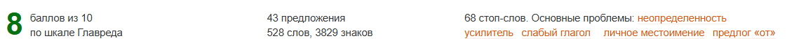

# Симонов Е.Д. 4ИСИП-923. Тема 3: Создание и реализация стратегии контент-маркетинга, написание SEO-оптимизированного контента

<strong>Цель:</strong> Разработать стратегию контент-маркетинга для собственного веб-приложения, составить контент-план, написать и опубликовать на сайте полезную SEO-оптимизированную статью, проверить качество текста с помощью специализированных сервисов и оценить его соответствие требованиям поисковых систем.

<strong>Предметная область:</strong> веб-приложение Minecraft-сервера "Мир студента IT"

## 1. Разработка стратегии контент-маркетинга

<strong>Цель контент-маркетинга:</strong> привлечение целевого поискового трафика и повышение доверия к проекту. Основная задача - стать полезным ресурсом для игроков, которые ищут информацию о настройке скинов, плащей и развитии на сервере.

### Портреты целевой аудитории (персоны):

- Персона 1 "Новичок": только начал играть на сервере, хочет выделиться, но боится потерять деньги. Его главная боль - страх мошенничества и непонимание, чем косметика отличается от нечестной игры.

- Персона 2 "Опытный": играет давно, регулярно покупает косметику. Интересуется редкими дизайнами, новинками и безопасностью транзакций. Ищет обзоры, сравнения цен и подтверждение того, что магазин не продаст его данные.

Форматы контента и каналы: основной упор сделан на SEO-статьи и гайды (для поискового трафика), а также кейсы и чек-листы (для доверия). Каналы распространения: блог на сайте (основной), сообщество сервера в ВК (анонсы), ВК видео (визуальные обзоры косметики).

## 2. Составление контент-плана на месяц

В таблице 1 представлен контент-план на месяц.

Таблица 1 - Контент-план на месяц

<table>
  <thead>
    <tr>
      <th>№</th>
      <th>Дата</th>
      <th>Тема</th>
      <th>Формат</th>
      <th>Персона</th>
      <th>Основной запрос (Вордстат)</th>
      <th>Канал</th>
    </tr>
  </thead>
  <tbody>
    <tr>
      <td>1</td>
      <td>01.12</td>
      <td>Как купить косметику на сервере</td>
      <td>Статья</td>
      <td>Новичок</td>
      <td>купить косметику майнкрафт безопасно</td>
      <td>Блог</td>
    </tr>
    <tr>
      <td>2</td>
      <td>05.12</td>
      <td>Обзор сезонных плащей "Зима 2026-2027": что выбрать?</td>
      <td>Обзор</td>
      <td>Опытный</td>
      <td>плащи майнкрафт купить</td>
      <td>Блог, ВК</td>
    </tr>
    <tr>
      <td>3</td>
      <td>08.12</td>
      <td>Почему косметика на нашем сервере не нарушает принцип честной игры</td>
      <td>Статья</td>
      <td>Новичок</td>
      <td>косметика майнкрафт без читов</td>
      <td>Блог</td>
    </tr>
    <tr>
      <td>4</td>
      <td>12.12</td>
      <td>Топ-5 шляп: стиль и удобство</td>
      <td>Подборка</td>
      <td>Опытный</td>
      <td>шляпы майнкрафт купить</td>
      <td>Блог</td>
    </tr>
    <tr>
      <td>5</td>
      <td>15.12</td>
      <td>Что такое донат-валюта и как её получить законно</td>
      <td>Гайд</td>
      <td>Новичок</td>
      <td>донат майнкрафт купить</td>
      <td>Блог</td>
    </tr>
    <tr>
      <td>6</td>
      <td>19.12</td>
      <td>Сравнение цен на косметику: наши цены против цен конкурентов</td>
      <td>Кейс</td>
      <td>Опытный</td>
      <td>донат магазин майнкрафт</td>
      <td>Блог, ВК</td>
    </tr>
    <tr>
      <td>7</td>
      <td>22.12</td>
      <td>Пять признаков мошеннического донат-магазина</td>
      <td>Чек-лист</td>
      <td>Новичок</td>
      <td>как проверить донат магазин</td>
      <td>Блог</td>
    </tr>
    <tr>
      <td>8</td>
      <td>26.12</td>
      <td>Интервью с администратором: как устроена безопасность на сервере</td>
      <td>Статья</td>
      <td>Опытный</td>
      <td>безопасность майнкрафт сервер</td>
      <td>Блог</td>
    </tr>
  </tbody>
</table>

<strong>Обоснование распределения:</strong> 5 публикаций (62%) являются информационными (гайды, чек-листы, объяснение принципа честной игры). Они приводят "холодный" трафик из поиска и формируют доверие. 3 публикации (38%) - коммерческие (обзоры, подборки, сравнение цен). Они нацелены на "горячую" аудиторию, готовую к покупке. Такое соотношение позволяет не только продавать, но и строить долгосрочные отношения с аудиторией.

## 3. Подготовка семантики и структуры статьи

Для написания выбрана тема "Почему косметика на нашем сервере не нарушает принцип честной игры" (публикация №3).

Основной запрос: "косметика майнкрафт без читов"

Дополнительные запросы:

- косметика в майнкрафте читы или нет

- безопасная косметика майнкрафт

- купить скины и плащи

- донат косметика

- не нарушает правила

- честная игра

- где купить плащ

- как установить скин

- сервер без читов

- визуальные улучшения

Структура статьи:

- H1: почему косметика в Minecraft не является читами и не нарушает честную игру

- H2: что такое косметика и как она работает в игре

- H2: главное отличие: визуальные изменения против игрового преимущества

- H3: почему Pay-to-Win - это плохо, а косметика - нет

- H2: как технически реализована безопасная косметика

- H2: почему серверам нужна донат-косметика

- H2: чек-лист: как проверить донат-магазин на честность (маркированный список)

- H2: заключение: играйте честно и выглядите стильно (вывод с призывом к действию - переход в каталог)

Метатеги:

- Title: косметика в Minecraft без читов: почему это честно и безопасно

- Description: разбираемся, почему покупная косметика (скины, плащи) в Minecraft не является читами и не дает преимуществ в честной игре. Гайд по безопасному донату.

## 4. Написание статьи и проверка качества текста

По составленной структуре была написана статья. Текст проверялся на уникальность, водность, тошноту и стилистику. После первичной проверки были удалены канцеляризмы, вводные конструкции и "вода", после чего проведена повторная проверка.

### Текст статьи:

Многие игроки, особенно новички, часто задаются вопросом: не является ли покупная косметика в Minecraft читами? Не нарушает ли это принцип честной игры? В этом гайде мы подробно разберем, что такое донат-косметика, почему она не дает игрового преимущества и как отличить безопасный магазин от мошеннического.

#### Что такое косметика и как она работает в игре

Косметика в Minecraft - это любые визуальные изменения внешнего вида вашего персонажа или его окружения. Сюда относятся скины, плащи, шляпы, частицы (эффекты вокруг игрока), анимации и следы от шагов.

Главное правило любой честной косметики: она видна только вам и другим игрокам, но никак не влияет на механику игры. Вы не станете бегать быстрее, наносить больше урона или видеть врагов сквозь стены. Ваша экипировка остается прежней, меняется лишь визуальная обертка.

#### Главное отличие: визуальные изменения против игрового преимущества

В игровой индустрии существует понятие Pay-to-Win (P2W) - модель, при которой игроки могут купить реальное игровое преимущество за деньги. Например, более мощное оружие, ускоренную прокачку или эксклюзивные способности. Именно такая модель разрушает баланс и убивает интерес к честной игре.

Косметика же работает по принципу Pay-to-Look-Good. Вы платите только за то, чтобы выделиться на фоне других, выразить свою индивидуальность или поддержать любимый сервер. В PvP-сражениях игрок в дорогом плаще и игрок в стандартном скине Стива имеют абсолютно равные шансы на победу. Побеждает тот, у кого лучше реакция и тактика, а не тот, кто больше заплатил.

#### Как технически реализована безопасная косметика

С технической точки зрения, косметические предметы хранятся на сервере в базе данных и привязаны к вашему аккаунту. При входе в игру специальный плагин считывает ваши настройки и применяет визуальные эффекты только на клиентской стороне. Это означает, что файлы игры на вашем компьютере не модифицируются, а сервер не передает никаких запрещенных пакетов данных. Античит-системы легко отличают законный косметический плагин от запрещенных модификаций, поэтому вам не грозит бан за использование "читов".

#### Почему серверам нужна донат-косметика

Содержание крупного Minecraft-проекта требует значительных затрат. Аренда выделенного сервера, защита от DDoS-атак, покупка плагинов и оплата работы модераторов - всё это требует стабильного финансирования. Донат-косметика является основным законным способом монетизации для серверов, которые уважают своих игроков и не хотят вводить Pay-to-Win элементы. Покупая плащ или скин, вы напрямую инвестируете в стабильность и развитие проекта.

#### Чек-лист: как проверить донат-магазин на честность

- Чтобы быть уверенным в безопасности своих покупок, используйте этот простой чек-лист перед оплатой:
Наличие официального сайта и сообщества. У честного проекта всегда есть группа в социальной сети (сетях), где общаются игроки и администрация.

- Прозрачные правила. На сайте должен быть раздел с правилами, где четко прописано, что косметика не дает преимуществ.

- Безопасные способы оплаты. Магазин должен принимать платежи через официальные шлюзы, а не просить перевод на карту физического лица.

- Отзывы и репутация. Проверьте мониторинги серверов и форумы. У надежного проекта всегда есть история и положительные отзывы.

- Техническая поддержка. Если у вас возникли проблемы с начислением предмета, администрация должна быть на связи и готова помочь.

#### Заключение: играйте честно и выглядите стильно

Покупка косметики - это отличный способ поддержать сервер, на котором вы играете. Помните: настоящая честная игра строится на вашем мастерстве, а не на кошельке. Выбирайте безопасные магазины, выделяйтесь из толпы и наслаждайтесь игрой!

Хотите подобрать идеальный скин или плащ? Переходите в наш каталог косметики и создавайте уникальный образ для своего героя уже сегодня!

На рисунке 1 представлен анализ текста с помощью сервиса Главред

Рисунок 1 - Анализ текста с помощью сервиса Главред

## 5. Публикация статьи на сайте с технической SEO-оптимизацией

## 6. Рекомендации по развитию контент-маркетинга проекта

Для анализа результативности контент-маркетинга необходимо отслеживать следующие показатели:

- Посещаемость страницы и динамика роста органического трафика.

- Время на странице (показывает, насколько контент увлекателен и полезен).

- Глубина просмотра (переходы по внутренним ссылкам в каталог и на другие статьи).

- Позиции в поисковой выдаче Яндекса и Google по целевым ключевым запросам.

- Конверсии (переходы из статьи в магазин косметики и фактические покупки).

Повторное использование материала:

- Социальные сети (ВКонтакте): разбить статью на серию коротких постов с каруселями картинок (например, пост "Топ-5 признаков честного магазина" или "Pay-to-Win vs косметика").

- Видео (VK Клипы): записать короткое видео на 60 секунд, где на фоне геймплея голосом за кадром объясняется главное отличие косметики от читов.

- Email-рассылка: отправить дайджест "Как не попасть на удочку мошенников" по базе зарегистрированных игроков.

Полезный SEO-текст против текста "для роботов":

- Полезный SEO-текст пишется в первую очередь для людей: он закрывает их боли, отвечает на вопросы, читается легко и естественно. Ключевые слова в нем используются органично и не режут слух. Текст "для роботов" содержит неестественные вхождения ключей, канцеляризмы, "воду" и повторяющиеся фразы.

- Поисковые системы понижают переоптимизированные тексты, потому что они ухудшают пользовательский опыт. Если человек открывает статью и видит набор ключевых слов, он быстро закрывает страницу, что сигнализирует поисковику о низком качестве ресурса.

### Вывод

В ходе выполнения практической работы была разработана и реализована стратегия контент-маркетинга для веб-приложения Minecraft-сервера "Мир студента IT".

- Сформулированы цели продвижения и составлены портреты целевой аудитории (новички и опытные игроки).

- Создан контент-план на месяц из 8 публикаций с грамотным балансом информационных и коммерческих тем.

- Собрана поисковая семантика, проанализированы конкуренты и составлена детальная структура SEO-статьи.

- Написан уникальный и полезный текст объемом более 3 000 знаков, который успешно прошел проверку в сервисе Главред

- Статья опубликована на сайте с применением технической SEO-оптимизации: настроены метатеги, добавлены изображения с alt, - внедрены внутренние ссылки и микроразметка Schema.org (JSON-LD).

- Сформулированы рекомендации по аналитике и ресайклингу контента.

Практическая работа показала, что комплексный подход к созданию контента - от анализа ЦА до технической оптимизации - является ключевым фактором для привлечения органического трафика и повышения доверия к проекту.